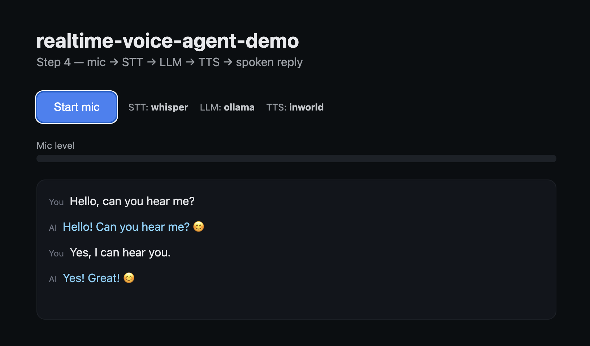

# realtime-voice-agent-demo

リアルタイム音声AIアシスタントのデモ。マイクに話しかけると、アシスタントが聞き取り、
考え、低遅延の音声でストリーミング応答します。UIから2つのモードをライブ切替できます。

- **Talk** — アシスタントと会話する。
- **Translate** — 同じパイプラインが同時通訳になる。ある言語で話すと、別の言語に翻訳した
  音声が返る（言語ペアはUIで選択）。

**完全オフライン・キーゼロ**でも動作し（ローカルのSTT/LLM/TTS）、品質重視ならクラウド
プロバイダも使えます。各段はアダプタ境界の内側で差し替え可能です。



## アーキテクチャ

```
ブラウザ (Next.js/React/TS)              バックエンド (Python/FastAPI)
  マイク ──AudioWorklet──▶ PCM ──┐
                                │  WebSocket（双方向）
  再生 ◀── 音声チャンク ──────────┤◀──▶  STT(stream) → LLM(stream) → TTS(stream)
  波形/字幕 UI ◀─────────────────┘        会話状態機械 ＋ barge-in
                                          STT/LLM/TTS はアダプタ境界の内側
```

- **cascading パイプライン**（STT → LLM → TTS）。各段を実行時に差し替え可能。
- **barge-in** — アシスタントの発話中に話しかけると、止まって聞く側に回る。
- **差し替え可能なプロバイダ** — UIからライブ切替。

## 前提

- Python 3.12+（[`uv`](https://docs.astral.sh/uv/)）、Node.js 18+。
- 既定は**ローカル・キーゼロ**（whisper + ollama + piper）。そのため
  [Ollama](https://ollama.com) の起動（`ollama serve`）とモデル取得
  （`ollama pull qwen3:0.6b`）が必要。Piperの音声モデルは初回に自動DL。
- クラウドプロバイダ（Deepgram / Kimi / Claude / Inworld）はオプトイン。各自のキーが必要（下記）。

## クイックスタート

```sh
make install   # backend(uv) + frontend(npm) 依存導入
make dev        # backend :8000 / frontend :3000
```

http://localhost:3000 を開きマイクを許可。既定設定なら**APIキー不要**で完全ローカル動作します。
クラウドプロバイダを使う場合は `backend/.env.example` を `backend/.env` にコピーし、
該当キーと `*_PROVIDER` を設定してください。

## プロバイダ

すべてアダプタ境界（`backend/app/adapters/`）の内側にあり、`.env` の `*_PROVIDER` で
既定を選び、UIや設定でライブ切替できます。

- **STT**: `whisper`（既定・ローカル・キー不要・オフライン）/ `deepgram`（クラウド・要 `DEEPGRAM_API_KEY`）
- **LLM**: `ollama`（既定・ローカル・キー不要、既定モデル `qwen3:0.6b`）/ `kimi`（要 `MOONSHOT_API_KEY`）/ `claude`（要 `ANTHROPIC_API_KEY`）
- **TTS**: `piper`（既定・ローカル・キー不要、音声は初回自動DL）/ `inworld`（クラウド・要 `INWORLD_API_KEY`）/ `hume`（雛形のみ・未実装）

## 主な機能

- **マイク → STT → LLM → TTS** のストリーミングパイプライン（WebSocket）。
- **Talk** と **同時通訳** モードをUIから切替。
- **barge-in**: 発話中の割り込み。
- **プロバイダのライブ切替**（STT/LLM/TTS）。
- **完全オフライン・キーゼロ**構成（whisper + ollama + piper）。
- **TTS評価ハーネス** `/bench` — 同一台本で各プロバイダ（Inworld vs Piper）を遅延・音声で比較。

## コマンド

| コマンド | 説明 |
|---------|------|
| `make install` | backend + frontend の依存導入 |
| `make dev` | 両サーバ起動 |
| `make lint` / `make typecheck` / `make test` | 品質ゲート |
| `make build` | フロントエンドのビルド |

## ライセンス

MIT — [LICENSE](LICENSE) を参照。
