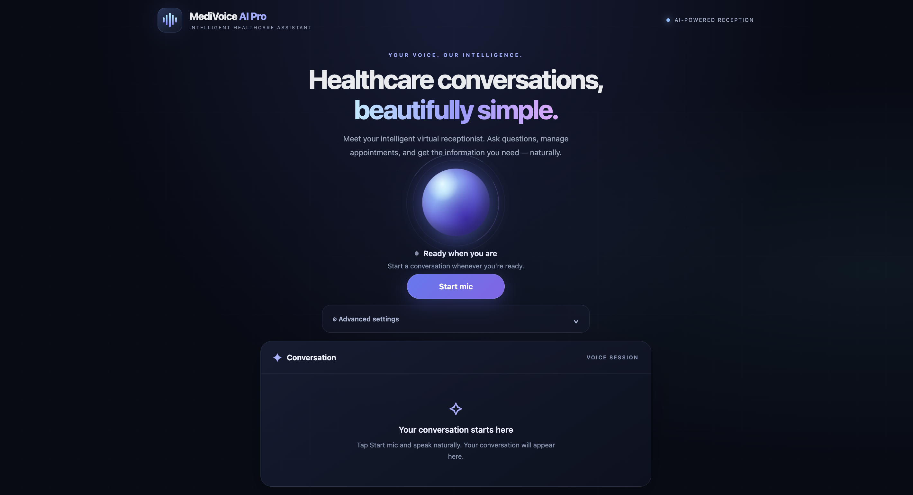

# MediVoice AI Pro

### AI-Powered Healthcare Voice Receptionist

**MediVoice AI Pro** is a conversational AI voice receptionist prototype designed for GP practices and healthcare administrative workflows.

It combines real-time speech processing, large language models, retrieval-augmented generation (RAG), and structured appointment booking to help patients access clinic information through natural conversation.

Built with **Next.js, FastAPI, Google Gemini, faster-whisper, Piper TTS, FAISS, and SQLite**.

> **Disclaimer:** This is a demonstration project, not a clinically validated or production-ready medical system. It does not provide diagnoses, prescribe medication, or replace qualified healthcare professionals.

## Key Features

- **Voice conversations:** Speech-to-text, AI-generated responses, and text-to-speech.
- **Clinic knowledge RAG:** Retrieves relevant information from a clinic knowledge base using vector similarity search.
- **Appointment booking:** Conversational booking workflow with SQLite persistence.
- **Medical safety guardrails:** Designed to avoid medical diagnosis, unsafe medication recommendations, and inappropriate handling of emergencies.
- **AURA interface:** Interactive voice assistant interface built with Next.js and React.
- **Provider-based architecture:** Modular components for speech recognition, language models, and speech synthesis.

## System Architecture

```text
Patient / Browser
        |
        v
Next.js + React (AURA Interface)
        |
        | WebSocket
        v
FastAPI Backend
        |
        v
Speech-to-Text (faster-whisper)
        |
        v
Conversation & Intent Processing
        |
        +----> Gemini 2.5 Flash
        |
        +----> RAG Retrieval
        |       |
        |       +--> Sentence Transformers
        |       +--> FAISS Vector Index
        |       +--> Clinic Knowledge Base
        |
        +----> Appointment Booking
        |       |
        |       +--> SQLite
        |
        +----> Safety Guardrails
        |
        v
Text-to-Speech (Piper)
        |
        v
Spoken Response to Patient
```

## Technology Stack

| Layer | Technology |
|---|---|
| Frontend | Next.js, React, TypeScript |
| Backend | Python, FastAPI |
| LLM | Google Gemini 2.5 Flash |
| Speech Recognition | faster-whisper |
| Speech Synthesis | Piper TTS |
| Vector Search | FAISS |
| Embeddings | Sentence Transformers |
| Database | SQLite |
| Communication | WebSockets |

## Retrieval-Augmented Generation

The RAG subsystem uses a clinic-specific knowledge base to provide context for administrative questions.

The retrieval workflow includes:

1. Preparing clinic information for indexing.
2. Generating semantic embeddings using Sentence Transformers.
3. Storing vectors in a FAISS index.
4. Retrieving relevant information for patient questions.
5. Supplying retrieved context to the response-generation workflow.

The knowledge base is located at `backend/knowledge_base/clinic_information.txt`.

## Appointment Booking

MediVoice AI Pro includes a conversational appointment booking workflow designed to collect relevant booking details and persist records locally.

SQLite is used for demonstration storage. The local appointment database is intentionally excluded from version control.

## Medical Safety

The system includes safeguards intended to support safer administrative interactions.

Examples include:

- Directing users with potentially life-threatening emergencies toward emergency services.
- Avoiding recommendations to independently change medication dosages.
- Keeping the assistant within an administrative rather than diagnostic role.
- Encouraging consultation with appropriate healthcare professionals for clinical questions.

These safeguards require further evaluation before any real-world healthcare deployment.

## Getting Started

### Prerequisites

- Python with the `uv` package manager
- Node.js and npm
- Git
- Google Gemini API credentials for the Gemini configuration
- Microphone access in the browser

### Installation

```bash
git clone https://github.com/Ankitesh17/MediVoice-AI-Pro.git
cd MediVoice-AI-Pro

make install
```

### Environment Configuration

Configure the backend's environment using the variables supported by the application.

For Gemini:

```env
GEMINI_API_KEY=your_api_key_here
GEMINI_MODEL=gemini-2.5-flash
```

Do not commit actual API keys or local environment files.

### Run the Application

```bash
make dev
```

Open the frontend at:

`http://localhost:3000`

The FastAPI backend runs on:

`http://localhost:8000`

### Development Commands

| Command | Purpose |
|---|---|
| `make install` | Install backend and frontend dependencies |
| `make dev` | Start both development servers |
| `make test` | Run configured tests |
| `make lint` | Run lint checks |
| `make typecheck` | Run type checks |
| `make build` | Build the frontend |

## Screenshots

### AURA — Healthcare Voice Assistant Interface



*Interactive voice assistant with a glowing AI orb, microphone controls, and real-time conversation panel.*

## Project Structure

```text
backend/
  app/
    adapters/
    rag/
    services/
    main.py
  knowledge_base/
  pyproject.toml

frontend/
  app/

Makefile
README.md
```

## Future Improvements

- Stronger automated safety and conversation evaluations.
- Improved appointment validation and workflow recovery.
- Authentication, access controls, and privacy safeguards.
- Production-grade observability and deployment infrastructure.
- Evaluation against realistic administrative conversations.

## Project Background

MediVoice AI Pro builds on the open-source [realtime-voice-agent-demo](https://github.com/0xkaz/realtime-voice-agent-demo) project, extending the voice-agent foundation with healthcare-oriented RAG, appointment booking, safety logic, and a customized AURA interface.

The original project's documentation is preserved in `README.original.md`.

## Author

**Ankitesh Narwariya**

GitHub: [Ankitesh17](https://github.com/Ankitesh17)

---

*Built as an AI engineering demonstration focused on conversational AI, voice interfaces, retrieval-augmented generation, and healthcare administration.*
