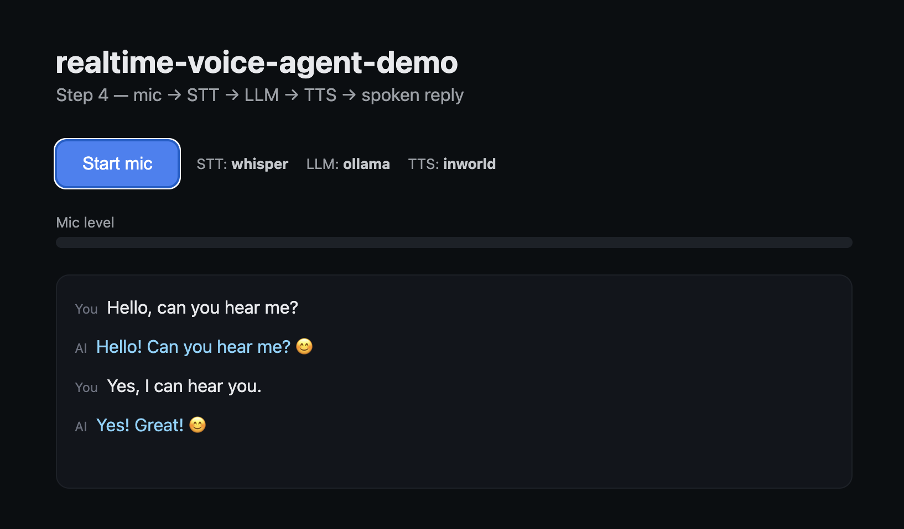
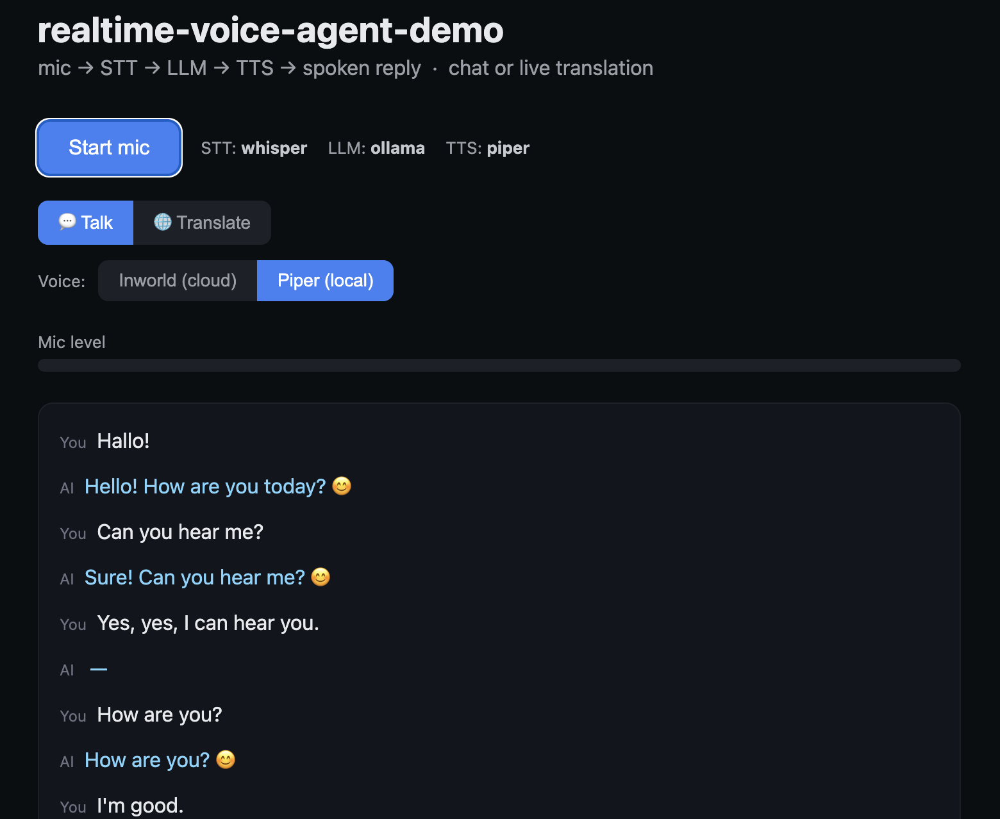

# realtime-voice-agent-demo

[](https://github.com/0xkaz/realtime-voice-agent-demo/actions/workflows/ci.yml)

A realtime voice AI assistant demo. Speak into your mic; the assistant listens,
thinks, and replies with low-latency, streamed speech. Two modes, switchable
live from the UI:

- **Talk** — the assistant converses with you.
- **Translate** — the same pipeline becomes a simultaneous interpreter: speak in
  one language, hear the translation spoken back in another (pick the language
  pair in the UI).

It can run **fully offline and key-free** (local STT + LLM + TTS), or use cloud
providers for higher quality — every stage is swappable behind an adapter.



## Architecture

```
Browser (Next.js/React/TS)            Backend (Python/FastAPI)
  mic ──AudioWorklet──▶ PCM ──┐
                              │  WebSocket (bidirectional)
  playback ◀── audio chunks ──┤◀──▶  STT(stream) → LLM(stream) → TTS(stream)
  waveform/caption/state UI ◀─┘       conversation state machine + barge-in
                                      STT/TTS/LLM behind adapter boundaries
```

- **Cascading pipeline** (STT → LLM → TTS), each stage swappable at runtime.
- **barge-in** — talk over the assistant and it stops to listen.
- **Pluggable providers** behind adapters, switchable live from the UI.

## Prerequisites

- Python 3.12+ with [`uv`](https://docs.astral.sh/uv/), Node.js 18+.
- The defaults are **local and key-free** (whisper + ollama + piper), so you
  also need [Ollama](https://ollama.com) running (`ollama serve`) with a model
  pulled (`ollama pull qwen3:0.6b`). Piper's voice auto-downloads on first use.
- Cloud providers (Deepgram / Kimi / Claude / Inworld) are **opt-in** and need
  their own keys (see below).

## Quick start

```sh
make install   # backend deps (uv) + frontend deps (npm)
make dev       # backend :8000, frontend :3000
```

Open http://localhost:3000 and allow microphone access. With the defaults it
runs entirely on your machine — **no API keys needed**. To use a cloud provider,
copy `backend/.env.example` to `backend/.env` and set the relevant key +
`*_PROVIDER`.

### STT provider

`/ws` streams transcripts using the provider chosen by `STT_PROVIDER`:

- `whisper` (default) — local faster-whisper, no API key, runs offline.
- `deepgram` — cloud streaming with native partials + end-of-turn; needs `DEEPGRAM_API_KEY`.

Both sit behind the same adapter (`backend/app/adapters/stt/`), so callers can't
tell which is active — set `STT_PROVIDER` in `backend/.env` to switch.

### LLM provider

On each *final* transcript the backend runs the LLM and streams its reply.
`LLM_PROVIDER` selects it:

- `ollama` (default) — local model via [Ollama](https://ollama.com)
  (`OLLAMA_MODEL`, default `qwen3:0.6b`). No key, no rate limits, latency-stable.
  Needs Ollama running (`ollama serve`) with the model pulled. Bump to a bigger
  model (e.g. `qwen3:14b`) for better answers.
- `kimi` — Moonshot Kimi (`kimi-k2.6`) via the OpenAI-compatible endpoint; needs
  `MOONSHOT_API_KEY`. (Hosted latency can be unpredictable on free tiers.)
- `claude` — Anthropic SDK (`claude-opus-4-8`, override with `CLAUDE_MODEL`);
  needs `ANTHROPIC_API_KEY`.

Same adapter boundary (`backend/app/adapters/llm/`) — Ollama and Kimi use the
OpenAI SDK, Claude uses the Anthropic SDK, callers see neither.

### TTS provider

The reply is synthesized to speech per sentence (so playback starts before the
full reply lands). `TTS_PROVIDER` sets the default; you can also **switch the
voice engine live from the UI** (local ↔ cloud):

- `piper` (default) — **local, offline, key-free**: Piper (ONNX/VITS) on CPU.
  Voice auto-downloads to `~/.local/share/piper-voices` on first use (~60 MB);
  pick a voice with `PIPER_VOICE` (default `en_US-lessac-medium`). Output is
  resampled to 16 kHz to match the pipeline.
- `inworld` — Inworld Realtime TTS (`inworld-tts-1.5-max`), cloud, more
  expressive; streaming NDJSON / LINEAR16 @ 16 kHz; needs `INWORLD_API_KEY`.
  Pick a voice with `INWORLD_VOICE_ID`.
- `hume` — scaffolded only (`backend/app/adapters/tts/hume.py` raises
  `NotImplementedError`); the adapter boundary is there for a future provider.

Same adapter boundary (`backend/app/adapters/tts/`) — the eval harness compares
the working providers (Inworld vs Piper) on one fixed script across it.

### Barge-in

If you start talking while the assistant is speaking, it stops immediately and
listens. The browser detects sustained speech over the assistant's audio, halts
playback, and sends `interrupt`; the backend cancels the in-flight LLM + TTS and
emits `assistant: interrupted`. Whatever was said before the cut stays in
history, so context is preserved. This is the centerpiece transition of the
conversation state machine.

### Local vs cloud

The demo can run **fully offline, key-free**: `whisper` (STT), `ollama` (LLM),
and `piper` (TTS) all run on-device. Inworld (cloud, more expressive) is the
default TTS, but flip the **Voice** toggle in the UI to `Piper (local)` and no
request leaves the machine. The cloud and local engines sit behind the same
`TTSAdapter`, so the swap is live and the rest of the pipeline is unchanged.

### TTS eval harness

`/bench` (linked from the main page) sends one fixed script to every TTS
provider and lays the results side by side: measured time-to-first-audio, total
synthesis time, audio length, a play button per provider, and a free notes field
for the subjective quality call. Backed by `POST /tts/synthesize`
(`{text, provider}` → metrics + base64 WAV). The idea is to
**choose a TTS by your own measurement, not the vendor's benchmark**. On one
local run, Piper's first-audio was ~130 ms vs Inworld's ~1.7 s — the local
engine far faster, the cloud one more expressive; the harness makes that
trade-off measurable instead of asserted. (Numbers depend on hardware/network.)



## Features

- **mic → STT → LLM → TTS** streaming pipeline over a WebSocket.
- **Talk** and **live translation** modes, switchable from the UI.
- **barge-in**: interrupt the assistant mid-reply by speaking.
- **Pluggable providers**, switchable live: STT (whisper / deepgram), LLM
  (ollama / kimi / claude), TTS (piper / inworld).
- **Offline, key-free by default** (whisper + ollama + piper).
- **TTS eval harness** at `/bench` for head-to-head provider comparison.

## Layout

```
backend/    FastAPI app — WebSocket hub, audio I/O, provider adapters
frontend/   Next.js app — mic capture, playback, UI
```

## Commands

| Command | Description |
|---------|-------------|
| `make install` | Install backend + frontend deps |
| `make dev` | Run both dev servers |
| `make lint` / `make typecheck` / `make test` | Quality gates |
| `make build` | Build frontend |

## CI

GitHub Actions ([`.github/workflows/ci.yml`](.github/workflows/ci.yml)) runs
backend lint/type-check/tests and frontend lint/type-check/build on every push
and PR. Tests stub all providers, so CI needs no models, network, or API keys;
the backend is type-checked and tested on Python 3.12 (the stated minimum). The
end-to-end voice path (Ollama / local models / cloud keys) is verified locally.

## License

MIT — see [LICENSE](LICENSE).

See [README.ja.md](README.ja.md) for Japanese.
